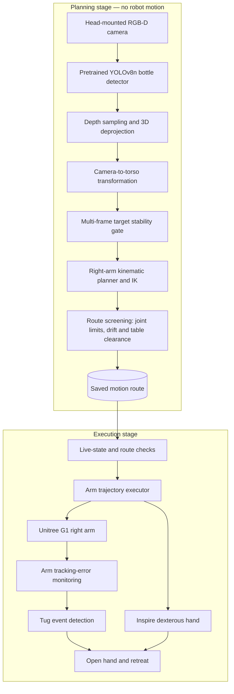

# G1 Bottle Pickup and Handover

## Overview

This project integrated RGB-D perception, 3D localisation, right-arm motion planning, dexterous grasping and a tug-triggered handover on a physical Unitree G1 humanoid equipped with an Inspire RH56DFTP hand.

The system detects an upright bottle on a table using the robot's head-mounted RGB-D camera, estimates its position relative to the robot, plans a route for the right arm, grasps and lifts the bottle, and opens the hand when a person pulls on the object.

The pipeline was brought together so that a single command could initiate perception, planning and execution. This was an operator-supervised demonstration, not an autonomous mobile manipulation system: the bottle was placed in advance, the robot operated with a harness, emergency stop and spotter, and a person initiated the handover by pulling the bottle.

## Engineering objective

The objective was to move from a camera observation to a complete physical pick-and-lift, then demonstrate a simple human handover. The system needed to account for uncertain camera-to-robot geometry, the restricted reach of a waist-locked arm, and the weight and tracking behaviour of the dexterous hand.

## System architecture

The implementation used two separate stages:

1. **Planning:** camera perception and route generation ran without commanding robot motion. A validated route was saved for the executor.
2. **Execution:** a separate process checked the saved route against the robot's live arm state, then controlled the arm and hand.

Perception and inverse-kinematics work were moved to background workers so that slow computation did not freeze the live camera interface. The planner used latest-frame queues and coordinated compute access rather than allowing the detection and IK tasks to compete without control.

## Technical approach

### 1. RGB-D perception

A pretrained YOLOv8 nano detector was used to identify the bottle class. The detector was not custom-trained as part of this project. The camera supplied aligned colour and depth images.

The detection centre was used as the image-space reference. Depth was estimated from valid pixels in a small region around that point using a median, then deprojected with the camera intrinsics to obtain a 3D point in the camera optical frame.

A target-stability gate required several fresh detections to agree within a small spatial tolerance before the target was accepted. This reduced the chance of planning from a single noisy or transient detection.

### 2. Camera-to-robot localisation

The camera-frame point was transformed into the robot's torso frame using the camera's nominal mounting geometry and an empirically measured pitch correction derived from a table-plane measurement.

This provided a robot-relative target for manipulation. It was not a full, independently validated hand-eye calibration: some scene and tool offsets were measured or adjusted manually, and absolute localisation error against ground truth was not measured.

### 3. Right-arm route planning and inverse kinematics

A Pinocchio-based kinematic model of the right arm was used with a pose-tracking inverse-kinematics routine. The waist remained locked.

The route was built from the arm's current measured pose and included:

- A route via a point that cleared the table edge.
- A pre-grasp pose.
- A final approach to the bottle.
- A lift segment after grasp closure.

The planner screened candidate motion for joint-limit compliance, per-step joint changes, accumulated drift, pose residual and fingertip clearance above the table. Starting from the live arm pose avoided commanding a discontinuous jump to the first waypoint.

### 4. Arm execution

The arm was position-controlled using the robot's SDK. Gravity feed-forward was adjusted to account for the added mass of the Inspire hand, reducing posture error caused by arm sag.

The first motion approach moved through stop-and-go segments. This was later changed to a continuous, speed-zoned profile with smoothed acceleration: the arm moved more quickly through open space and slowed near the bottle. A tracking-error watchdog could abort execution if the measured arm motion diverged too far from the command.

### 5. Grasping and lifting

The hand moved into a preshape as the arm approached the grasp pose. Finger closure then used per-finger timing and force limits. A grasp check was used before lifting, and finger-position creep after closure was recorded as an additional indicator of whether the grip remained stable.

The grasp configuration that worked was kept fixed during later approach-path tuning. When faster approach motion caused the fingers to contact the bottle prematurely, the approach geometry was adjusted rather than repeatedly changing a grasp that had already worked.

### 6. Tug-triggered handover

After lifting the bottle, the system monitored the arm's tracking error relative to a moving reference. A sustained change was interpreted as a person pulling on the bottle; the hand was then commanded to open, followed by an arm retreat.

The hand's tactile and force channels were available for monitoring, but the force readings were too noisy to serve as the main tug signal. The implemented detector relied primarily on arm tracking-error change, with a settling period before monitoring began.

## My contribution and use of AI-assisted development

This project used substantial AI-assisted coding with Claude. The distinction between my work and the tools and libraries is important.

**My work included:**

- Specifying the manipulation objective and progressively defining the required behaviour: reliable grasping, smoother reach motion, one-command operation and tug-triggered handover.
- Operating the physical robot during experiments under a harness, emergency-stop procedure and spotter supervision.
- Measuring scene geometry and camera pitch, selecting test positions, and evaluating the physical grasp and lift.
- Reviewing experiment logs and robot behaviour to identify issues such as stale detections, premature finger contact, arm sag and a hand stopping short.
- Deciding which corrections to retain, including preserving a known-good hand-grasp configuration while adjusting the approach.
- Integrating and validating the camera, planning, arm-control and hand-control stages as one working sequence.

**AI assistance and existing components:**

Claude wrote and revised substantial portions of the implementation from my specifications, observations and logs, including parts of the motion-profile, automation and tug-detection logic. The project also used existing YOLOv8, RealSense, Pinocchio and vendor SDK components. I do not claim those libraries, pretrained models or vendor interfaces as original work.

## Physical validation and demonstrated outcomes

The following results are supported by the available project logs or operator reports:

| Demonstration | Evidence and scope |
|---|---|
| Integrated detection, localisation, planning, reach, grasp and lift | Repeated physical-robot runs initiated through one command; no complete trial denominator is available |
| Successful bottle lift | Logged successes include an earlier lift trial and later tests at three bottle positions |
| Multiple target positions | Demonstrated at several positions inside a small reachable zone; not an arbitrary workspace |
| Continuous arm reach | A logged run completed the continuous reach in approximately 20 seconds, replacing the earlier stop-and-go motion |
| Higher reach speed | A faster setting was reported to work at two positions; this was operator-reported |
| Tug detection | A tug event was recorded by the on-robot detector; the complete handover release was reported working |
| Tracking performance | Peak joint tracking error remained below approximately six degrees in the cited later test logs; this is not a general performance guarantee |
| Reach-envelope sweep | A grid of candidate positions was evaluated by the kinematic planner; this was a planning test, not a physical validation of every position |

There is no complete trial table, measured success rate, or localisation-accuracy evaluation against ground truth. Accordingly, this case study makes no numerical reliability or generalisation claim.

A separate vision-language-action policy experiment in simulation reached near the bottle but did not close the hand. It was not part of the physical pick-and-handover pipeline described here.

## Engineering challenges and lessons

### Arm sag and tracking lag

The arm and hand did not follow the ideal kinematic path perfectly under load. The hand's mass caused sag, and tracking lag meant that an apparently clear planned path could still result in finger contact with the bottle. Adding the hand's mass to the gravity feed-forward model mitigated this issue, although residual deflection remained at farther tested positions.

### Grasp contact depended on the approach path

After the reach was made faster, fingers contacted the bottle during approach. The grasp settings that had already produced a stable lift were kept unchanged; instead, the approach path was adjusted to provide more clearance. Additional forward travel was later added after the hand stopped short of the intended contact position.

### Detecting a human tug without relying on a force sensor

Early tug detection produced false triggers when its reference was established while the arm was still settling. Finger-force readings were also too noisy for dependable use. The detector was changed to compare tracking error against a moving reference and to wait through an initial settling period before checking for a tug.

### Perception latency and stale detections

CPU-only detection was slow enough that otherwise valid detections could be rejected by the original freshness check. The freshness handling was adjusted for a static bottle, while multi-frame spatial agreement remained as a safeguard. This improved the workflow but did not make perception real-time.

### Planner screening versus physical reach

An early reach sweep rejected many candidate positions because of a conservative planner drift constraint. Relaxing that planning constraint revealed the smaller region in which valid routes could be generated. This showed that a planner rejection is not, by itself, proof that a physical arm configuration is unreachable.

## Limitations

- **Restricted workspace:** the demonstrated bottle positions were in a small region in front of the robot. The waist was locked, limiting lateral reach.
- **Narrow object and scene scope:** testing used an upright bottle on one table. Other object shapes, orientations, clutter and multiple-object scenes were not demonstrated.
- **Calibration uncertainty:** localisation accuracy against ground truth was not measured. The camera transform used nominal mounting geometry with a measured pitch correction, and small hand-tuned offsets were needed.
- **Open-loop reach:** once the route was planned, the camera was not used to correct the trajectory during arm motion. A bottle moved after planning could therefore invalidate the route.
- **Perception speed:** CPU inference was slow and constrained the freshness of observations.
- **Handover evidence:** tug detection was tested with one operator. False-trigger and missed-detection rates were not measured.
- **Limited contact safety:** the arm used position control and tracking-error checks rather than a validated force-compliant controller. The demonstration required a harness, emergency stop and spotter.
- **No reliability statistic:** the available records do not support a success-rate claim or a claim of generalisation to arbitrary bottle positions.

## Future research directions

1. **Measured hand-eye calibration:** replace nominal camera and tool geometry with a measured calibration procedure.
2. **Closed-loop final approach:** use renewed visual observations or tactile feedback for the final part of the grasp rather than following a fixed route open loop.
3. **Wider reach envelope:** incorporate waist yaw into planning and validate the resulting workspace.
4. **Richer handover sensing:** combine arm tracking error, finger position and tactile signals; evaluate the detector over repeated pulls and quiet trials.
5. **Safer contact handling:** add validated torque/current limits and unexpected-load handling.
6. **More complete object perception:** estimate bottle geometry from multiple depth samples rather than relying on an assumed grasp height and a small depth region.
7. **Systematic evaluation:** retain a complete trial database and report success, failure and handover-detection rates across positions and speeds.
8. **Simulation evaluation:** reproduce the hardware pipeline in a physics simulator before expanding physical tests.

These are proposed research directions; they are not presented as completed features.

## Safety and disclosure

The reported physical demonstrations were performed with a safety harness, emergency stop and spotter. The system should not be interpreted as safe for unsupervised operation.

This is a high-level personal portfolio account of work performed in a collaborative robotics research environment. It intentionally excludes source code, model weights, internal network details, device paths, detailed controller settings and non-public implementation artefacts. It is not an official publication or endorsement by any institution or robot manufacturer.
