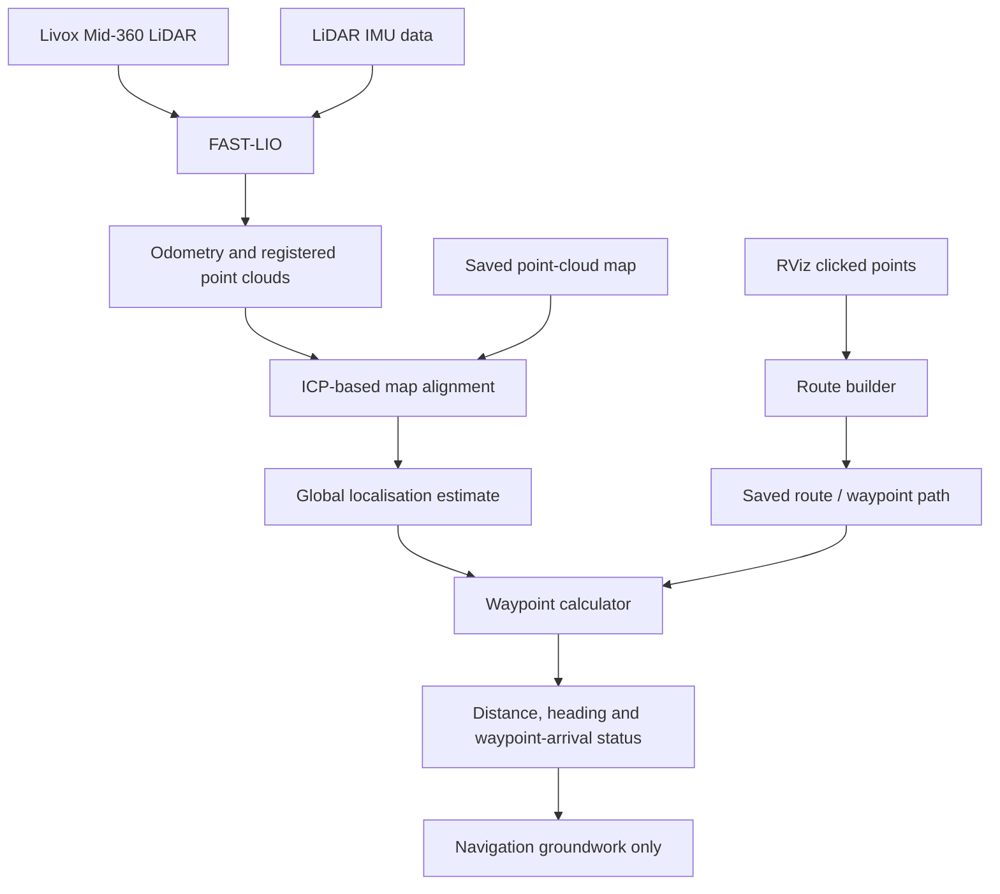

# LiDAR Mapping and Localisation for Unitree G1

## Overview

This project established a LiDAR-based mapping and localisation pipeline for a Unitree G1 humanoid robot using a Livox Mid-360 sensor and ROS 2. FAST-LIO was used to generate registered point clouds and odometry, while an additional ICP-based component aligned live scan information against a previously saved point-cloud map to produce a global localisation estimate.

A ROS 2 route-building and waypoint-calculation package was also developed as groundwork for navigation. The work reached mapping, map saving, localisation and waypoint calculation. **Autonomous waypoint walking was not completed or demonstrated in the documented project stage.**

## Objective

Develop a reliable spatial representation of the environment and estimate the G1's pose relative to a saved map, then prepare waypoint-planning components that could form the basis of a future autonomous navigation system.

## Hardware and software

| Component | Role |
|---|---|
| Unitree G1 humanoid | Robotic platform |
| Livox Mid-360 LiDAR | 3D environment sensing |
| LiDAR and IMU streams | Inputs to the mapping and odometry pipeline |
| ROS 2 Foxy | Robotics middleware |
| FAST-LIO | LiDAR-inertial odometry and registered point-cloud mapping |
| ICP-based localisation | Alignment of live scan information against a saved map |
| RViz | Visual waypoint selection |
| Custom ROS 2 route components | Route construction and waypoint-state calculation |

## System architecture

## Technical work

### 1. LiDAR integration and mapping

The Livox Mid-360 was integrated with the G1's ROS 2 environment. FAST-LIO consumed LiDAR and IMU data and produced odometry and registered point clouds while the robot moved through the environment.

The mapping workflow was brought to a state where point-cloud maps could be saved in PCD format. A documented map from a test area contained approximately 38,000 points.

### 2. Map-based localisation

FAST-LIO odometry alone provides a locally accumulated motion estimate. To obtain a pose estimate relative to a saved environment map, the project added an ICP-based localisation stage.

The localisation implementation included separate components for global scan-to-map alignment and transform fusion. The resulting localisation topic was observed to publish consistently at approximately 50 Hz during the documented tests.

### 3. Localisation validation

A controlled movement test was used to compare the estimated trajectory with the robot's movement. The handoff record describes an excursion of approximately 1–1.7 m followed by a return, with approximately 7 cm of planar return error.

This was a controlled localisation test. It should not be interpreted as a comprehensive accuracy benchmark, long-duration drift evaluation, or autonomous navigation result.

### 4. Waypoint and route construction

A separate ROS 2 package provided two pieces of route functionality:

- **Route builder:** accepted points selected in RViz, assembled them into a route, and supported saving and loading route data.
- **Waypoint calculator:** consumed the route and the current localisation estimate, calculated distance and desired-heading error, and reported when the current waypoint was within its arrival tolerance.

The waypoint calculator was explicitly limited to reporting route progress. It did not issue locomotion commands to the G1.

## Native navigation investigation

The project also investigated the G1's native SLAM and relocation interfaces. Native SLAM/navigation had previously been demonstrated by a mentor in a small area. However, a point-cloud map generated by the FAST-LIO workflow was not accepted directly by the native relocation path in the tested configuration.

Rather than treating the map formats as interchangeable, the project retained the FAST-LIO and ICP localisation path for the custom localisation work.

## My involvement

The work involved bringing up and testing the LiDAR mapping pipeline on the G1, saving and inspecting point-cloud maps, integrating and debugging the map-based localisation components, validating localisation through controlled robot movement, and developing the route-building and waypoint-calculation workflow.

The documentation available for this project does not establish authorship of every source file or distinguish every implementation contribution from AI-assisted development. Accordingly, this case study focuses on the system integration, experiments and outcomes that are supported by the project record rather than claiming every underlying algorithm or component as original work.

## Demonstrated outcomes

| Capability | Documented result |
|---|---|
| Livox Mid-360 integration | Sensor data used by the ROS 2 mapping workflow |
| FAST-LIO mapping | Working; registered point clouds generated |
| PCD map saving | Working |
| ICP-based global localisation | Working in the documented setup |
| Localisation output | Approximately 50 Hz in the recorded handoff |
| Controlled movement check | Approximately 1–1.7 m excursion and return, with about 7 cm planar return error |
| RViz route construction | Waypoint path creation and save/load functionality implemented |
| Waypoint calculation | Distance, heading error and waypoint-arrival reporting implemented |
| Autonomous waypoint walking | Not completed or demonstrated in the documented project stage |

## Limitations and scope

- **No completed autonomous navigation:** the route and waypoint components did not command the robot to walk.
- **Localisation test scope:** the recorded movement test was controlled and short; it does not establish long-term drift, robustness across environments or navigation performance.
- **Map compatibility:** the FAST-LIO-generated PCD was not directly accepted by the native relocation path in the tested configuration.
- **No obstacle-aware path planner:** route construction and waypoint calculations should not be confused with collision-aware planning.
- **No autonomous route execution:** waypoint arrival was calculated and reported, but a validated controller connecting route progress to safe G1 locomotion was not completed.

## Future work

1. Connect the waypoint calculator to a separately validated locomotion interface.
2. Begin with offline command calculation and short, supervised tests in a clear environment.
3. Add stale-localisation checks, stop conditions and explicit operator override.
4. Evaluate waypoint tracking, heading convergence and repeatability over multiple routes.
5. Investigate map-format conversion or a documented interface if integration with native relocation is required.
6. Add obstacle-aware planning only after reliable waypoint following is established.

These are proposed next steps, not completed project features.

## Safety and disclosure

The work described here involved a physical humanoid robot. Autonomous waypoint walking is not claimed. Any future motion-controller integration requires staged validation and appropriate supervision.

This is a high-level personal portfolio account. It excludes source code, internal network details, device paths, detailed configuration values and non-public implementation artefacts. It is not an official publication or endorsement by any institution or robot manufacturer.
